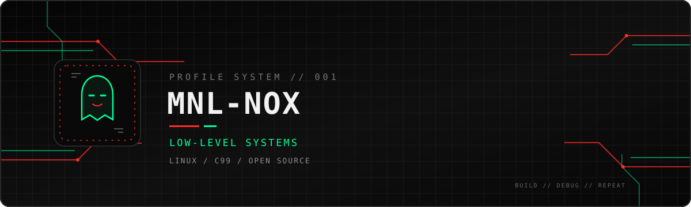
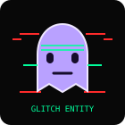
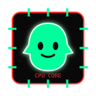
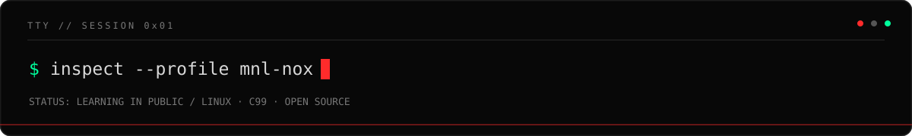
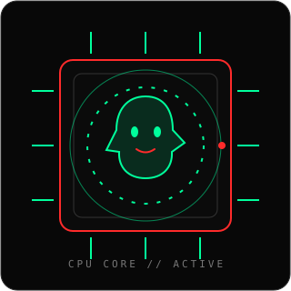

<!--
  MNL-NOX // PROFILE DASHBOARD
  Visual system: near-black / crimson / terminal green
  Live cards are provided by public GitHub stats and Shields.io endpoints.
-->

  

<h1 align="center">MANOEL E. S. S. <code>// mnl-nox</code></h1>

  <code>LOW-LEVEL SYSTEMS</code> &nbsp; <code>LINUX</code> &nbsp; <code>OPEN SOURCE</code> &nbsp; <code>ALWAYS LEARNING</code>

  
  
  
  

  
  
  

## `INDEX // NAVIGATION`

  <a href="#live-website">WEBSITE</a> &nbsp;·&nbsp;
  <a href="#operator-profile">PROFILE</a> &nbsp;·&nbsp;
  <a href="#live-profile-dashboard">LIVE DASHBOARD</a> &nbsp;·&nbsp;
  <a href="#repository-control-room">PROJECTS</a> &nbsp;·&nbsp;
  <a href="#skill-tree">SKILLS</a> &nbsp;·&nbsp;
  <a href="#activity-trophies">ACTIVITY</a>

---

## `00 // LIVE WEBSITE`

  
  

## `01 // OPERATOR PROFILE`

IT student pursuing a **Bachelor's degree in Information Systems** and a **Technology Degree in Systems Analysis and Development (ADS)**, alongside **parallel studies in Computer Science**. My learning path combines formal education with independent study of computer science fundamentals, software engineering, Linux, computer architecture, C programming, and open-source development.

I prefer understanding what happens below the abstraction: how programs are compiled, how operating systems expose hardware, how errors should be handled, and how small tools become maintainable projects.

**Current objective:** strengthen engineering fundamentals, document the process, and build practical software while seeking a first professional opportunity in technology.

  
  
  

## `02 // LIVE PROFILE DASHBOARD`

<table width="100%">
  <tr>
    <td width="50%" align="center" valign="top">
      
    </td>
    <td width="50%" align="center" valign="top">
      
    </td>
  </tr>
</table>

  

  

### `SIGNAL MONITOR // LIVE TELEMETRY`

  

  
  
  

### `REPOSITORY HEALTH // CHANGE FLOW`

  
  
  
  

  

### `SYSTEM CORE // TELEMETRY`

  

  <code>LIVE METRICS ARE SERVICE-DEPENDENT // PUBLIC DATA ONLY // CACHE AND RATE LIMITS MAY APPLY</code>

### `PROJECT SIGNALS // QUICK ACCESS`

  
  

  
  

---

## `03 // REPOSITORY CONTROL ROOM`

Live badges below track public repository metadata. Click a project name to open its source; click the issue/PR badges to inspect the current queue.

### `CPU READER` — C99 / Linux CPU monitor

A C99 library and monitor for Linux that reads CPU model and topology, calculates aggregate usage from `/proc/stat`, and checks temperature/frequency when compatible kernel interfaces are available. Includes terminal and GTK4 frontends, tests, and Debian packaging.

  
  
  
  

  
  
  

### `FILE MANAGER` — file-management experiments

  
  
  
  
  
  

### `BINLAB` — low-level lab

  
  
  
  
  
  

### `SIMPLEBASH` — shell scripting

  
  
  
  
  
  

  
  

---

## `04 // SKILL TREE`

*The tags below describe technologies used in projects or currently being studied. They are not a claim of expert-level proficiency.*

### `LANGUAGES & MARKUP`

  
  
  
  
  
  
  
  
  
  
  
  

### `COMPILERS, BUILD & DEBUGGING`

  
  
  
  
  
  
  
  
  
  
  

### `LINUX & SYSTEMS`

  
  
  
  
  
  
  
  
  
  

### `QUALITY, WORKFLOW & DOCUMENTATION`

  
  
  
  
  
  
  
  
  
  

### `COMPUTER SCIENCE & AREAS UNDER EXPLORATION`

  
  
  
  
  
  
  
  
  

---

## `05 // ACTIVITY & TROPHIES`

  

  <code>ACHIEVEMENT VAULT // UNLOCKED BY CONTRIBUTION</code>

  

  
  <code>XP + CONTRIBUTIONS + CONSISTENCY</code>
  

  
  

---

  

  <code>EVERY COMMIT IS A TRACE. EVERY ISSUE IS A TODO. EVERY PROJECT IS AN EXPERIMENT.</code>

  Evolution starts with curiosity, then becomes a habit.

