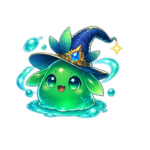

  

<h1 align="center">Manoel E. S. S</h1>

  <em>Building systems, absorbing knowledge, and evolving one skill at a time.</em>

---

## Adventurer's Log

I'm an Information Technology student pursuing a **Bachelor's degree in Information Systems (B.S. in Information Systems)** and a **Technology Degree in Systems Analysis and Development (ADS)**.

My learning path is strongly **self-taught**. I collect skills in software engineering, computer science, low-level programming, Linux, cybersecurity, artificial intelligence, and open-source technologies, then turn them into practical projects.

Currently, I am seeking my **first professional opportunity** in technology, where I can contribute to meaningful projects, learn from experienced people, and keep evolving my craft.

  

---

## Skills Absorbed

  
  
  
  
  
  
  
  
  
  
  
  

### Development

  
  
  
  
  
  
  
  
  
  

### Linux Realms

  
  
  
  
  
  

### Fields of Study

  
  
  
  
  
  

  

---

## Great Sage: GitHub Stats

  
  

---

  

  

---

## Mana Reserve

  

---

## Achievements Unlocked

  

---

## Magicalule Activity

  
  

  

  
   
  ✦ Every contribution is a fragment of mana gathered through code. ✦

---

> *Evolution starts with curiosity, then becomes a habit.*
