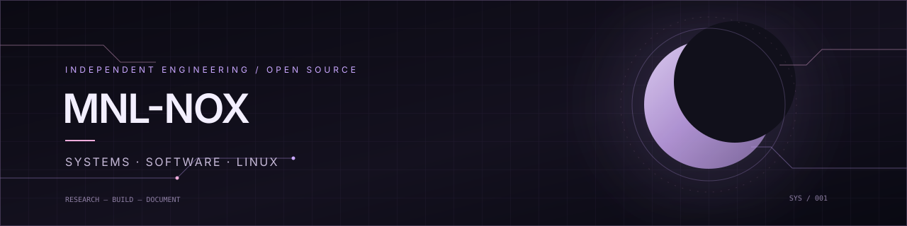
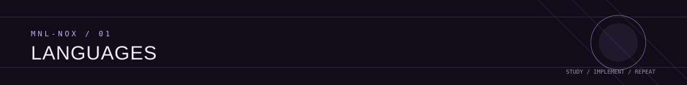
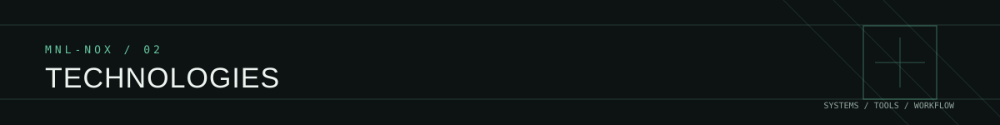
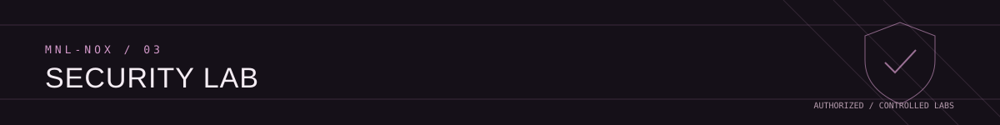

  

<h1 align="center">Manoel E. S. S.</h1>

<strong>Computer Science · Systems Programming · Linux</strong>

  <a href="https://mnl-nox.github.io/mnl-nox/">Portfolio</a>
  &nbsp;·&nbsp;
  <a href="https://www.linkedin.com/in/manoel-e-s-s-042691426/">LinkedIn</a>
  &nbsp;·&nbsp;
  <a href="mailto:ghostnether82@gmail.com">Email</a>
  &nbsp;·&nbsp;
  <a href="https://github.com/mnl-nox">GitHub</a>

---

## About

I am an Information Systems student also pursuing a degree in Systems Analysis and Development, with independent studies in computer science and software engineering.

My interests are centered on understanding software close to the machine: C programming, Linux, computer architecture, operating systems, debugging and the engineering practices behind reliable tools.

I value clear documentation, deliberate experimentation and learning by building.

## Independent Computer Science Study

Alongside formal education, I maintain an independent Computer Science study path focused on fundamentals and implementation: logic and mathematics, algorithms and data structures, C programming, computer architecture, operating systems, networks, web technologies and cybersecurity. The goal is to understand systems from first principles, validate concepts through practical experiments, and document the results in public projects.

## Current focus

- Systems programming in C and Linux
- Computer architecture and operating-system fundamentals
- Data structures, algorithms and software design
- Testing, debugging and maintainable open-source projects

## Selected projects

| Project | Description | Technologies |
|---|---|---|
| [CPU Reader](https://github.com/mnl-nox/cpu-reader) | Linux CPU and system monitor, with terminal and GTK4 interfaces | C99, Linux, GTK4 |
| [File Manager](https://github.com/mnl-nox/file-manager) | File-management project and systems programming practice | See repository |
| [BinLab](https://github.com/mnl-nox/BinLab) | Low-level programming experiments and utilities | See repository |
| [simpleBash](https://github.com/mnl-nox/simpleBash) | Shell scripting experiments | Bash |

[Browse all repositories →](https://github.com/mnl-nox?tab=repositories)

## Languages

**Primary / practical focus:** C, Bash.

**Also studying:** C++, Python, Assembly, C#, JavaScript and SQL. Skill labels describe study focus; they are not proficiency claims.

## Technologies & Engineering

**Operating systems & systems:** GNU/Linux, Debian, computer architecture, x86_64, memory, processes, filesystems, `/proc` and `/sys`.

**Build & debugging:** GCC, Clang, GDB, CMake, Make, GTK4.

**Development workflow:** Git, GitHub, CLI, documentation, unit testing, static analysis, sanitizers, CI/CD and reproducible builds.

**Web & networking:** HTML, CSS, JavaScript, TCP/IP, HTTP and network diagnostics.

## Reliability & Site Engineering

The portfolio is a static GitHub Pages site. Reliability work prioritizes low operational complexity: version-controlled changes, automated HTML and link checks, responsive regression review, accessible motion, and clear separation between first-party assets and optional third-party widgets. External GitHub statistics are non-critical and may fail without affecting navigation or core content.

## Security & Hacking Lab

Study areas: networking and service enumeration, web security, vulnerability analysis, traffic inspection, Linux hardening, digital forensics and defensive testing in authorized environments.

**Tool inventory:** the available conversation history does not preserve a reliable list of named hacking tools previously tested. I am not attributing tools such as scanners, proxies or exploitation frameworks to hands-on experience without confirmation. This section will list each tool with its actual lab use and repository notes as that inventory is documented.

---

  

  Build carefully. Understand deeply. Share what you learn.

